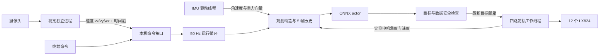

# 架构与实施路线

> 当前架构（2026-10-18）：本仓库是 robot-deploy；香橙派连接 USB 相机和 VL53L5CX I²C，运行感知/FSM/Actor；STM32 采集 IMU 和舵机反馈、执行目标。入口为 `config/robot-deploy.yaml`。以下保留早期直连设计依据，当前数据流以 [robot-deploy.md](robot-deploy.md) 为准。

本工程采用 Python 作为初期部署语言：可以直接检查观测数组、独立测试串口、快速替换 IMU/视觉算法；ONNX 推理和 OpenCV 的主要计算在原生库中完成。先测 CPU 推理及控制周期，出现性能瓶颈后再有针对性优化。

## 方案选择

| 方案 | 调试与实现成本 | 主要限制 | 本阶段判断 |
|---|---|---|---|
| STM32F4 单独跑策略/视觉 | 策略需移植推理库、内存规划，视觉通常还需外设 | 现有工程没有策略运行时；视觉扩展工作大 | 不作为最快起点 |
| 香橙派推理/视觉/ToF + STM32 舵机桥 | 复用固件的舵机收发控制 | RobotLink v1 已按相邻 C 源码实现，仍需板上联调 | 当前实施方案 |
| 香橙派全部处理 | 一套环境、便于日志与迭代 | Linux 非硬实时；四路半双工电路和回读必须验证 | 保留的早期调试方案 |

本项目已实现 `STM32Bridge`，复用 `JointIO` 接口。本次没有修改相邻 STM32 工程，不能由主机测试通过推断固件已烧录或链路已启用。

## 早期直连模块边界（backend=direct）

- `policy.py` 只接收观测数组，返回动作数组。
- `observation.py` 负责训练约定，不读取设备、不识别颜色。
- `config.py` 在硬件边界换算弧度/舵机原始计数。
- 每个 `LegWorker` 独占一个串口。一条总线上只有一个在途读请求，三关节轮询；四路之间并发。
- 目标使用覆盖式邮箱，积压时丢弃旧目标，不排队补发旧动作。
- IMU 更新不会阻塞推理；控制周期检查其采集时间。
- 视觉独立进程只发送速度指令。图像采集阻塞不会直接阻塞策略。
- 单进程中的 Python 线程和软件看门狗无法保证硬实时，也无法处理整个 Linux 挂死或进程被 SIGKILL 的情况。

## 借鉴 Microduck

参考的是用户提供的 `../microduck` 源码，尤其 `README.md`、`duck-control/src/policy.rs`、`docs/policy-manifest.md`、`docs/design/policy-channel-design.md`：

1. 50 Hz 小模型推理，ONNX Runtime 单计算线程。
2. 策略与硬件之间有显式契约，携带维度、动作尺度和训练来源。
3. 摄像头与控制循环分开，指令接口统一。
4. 先离线演练，再实际传感器回放/只读检查，再放开执行器。

Microduck 是另一种机构、舵机和观测布局（其文档中的 61 维观测/14 维动作与本机不同）。本工程独立实现 Robot12 适配；没有复制其 Rust 控制器、Dynamixel 电机驱动、双足策略或云更新系统。没有必要为了初版把整套机器人服务一起搬过来。

## 循线、转弯和越障

循线算法给出 `vx` 和 `wz`；策略只负责执行这些身体速度，转弯不由视觉直接改腿角度。当前保存的训练范围允许前进与偏航、侧向速度为零。遥控超出训练范围时限幅，零速度用于停车。

当前导入的训练参数是 `terrain_type: plane`，即使代码库存在 rough/competition 任务，也不能推断本模型掌握了越障。后续路线是：先验证站立/低速行走和转弯，测量 LX824 延迟/跟踪性能，再在训练中加入实测延迟、关节噪声和执行器响应，导入经过评估的粗糙地形策略。若需要主动识别障碍物，新增深度/ToF 或视觉识别模块，由任务层选择速度/步态或策略；当前未实现障碍检测、深度估计和自动跨越动作。

## 参考

- [ONNX Runtime Python：ARM 使用 CPU 包](https://onnxruntime.ai/docs/get-started/with-python.html)。
- [Microduck 源项目](https://github.com/pollen-robotics/microduck)，本次具体参考以用户本地版本为准。

