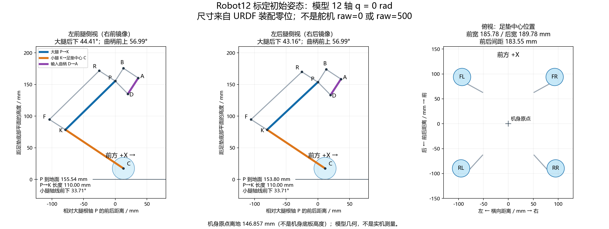

# Robot12 标定初始姿态

## 已记录的趴姿（2026-10-19）

用户已确认将 14:58:30（北京时间）采样记录中的最后一帧保存为**趴姿参考**，
文件为 [config/poses/prone.json](../config/poses/prone.json)。按舵机 ID 1–12：

```text
FL：765, 664, 482
FR：109, 370, 409
RL：510, 739, 606
RR： 91, 112, 354
```

单位为舵机原始计数，不是角度。采样期间 12 轴均有效，但 ID 3/4 等有变化；
文件保留各轴最小值、最大值和中位数，选定值明确使用最后一帧。
趴姿作为开机/起身流程的姿态参考，与下文模型站立零位 S0 分开记录；
目前尚未标定两者的角度映射、验证起身轨迹，也不会自动执行此文件中的位置。

## 确定的基准

采用 **本地 robot-lab 完整机构模型的装配零位**作为实机标定初始姿态，记为 S0：

- 机身水平，X 朝前、Y 朝左、Z 朝上。
- 12 个主动关节的模型角度全部为 **0 rad**，初始关节速度为 0。
- 左右腿镜像；前后腿膝部都向后弯，不把后腿翻成另一种装配分支。
- 对照模型的转轴中心、输入曲柄方向和足垫位置摆放，不凭舵机外壳方向判断关节角。

依据：`robot-lab/src/robot_lab/assets/robots/robot12.py` 的 `joint_pos={".*": 0.0}`，
本仓库保存的 `policies/robot12/training_env.yaml`，以及 `policies/model4497/manifest.json`
中的 `default_joint_pos`。4497 未附原训练参数，因此本页确定的是**当前部署所采用的基准**，
不能证明第三方训练时未改模型或初始关节定义。实物机构尺寸也需与此模型一致。

S0 是复位/标定姿态，不是“策略运行后必定静止保持的姿态”。策略会根据真实观测输出动作，
当前目标公式为 `q_target = q_default + 0.25 × action`；零速度命令也不保证 action 为零。
ONNX 输入全零的输出不能用作实机初始位置。

## 姿态对照图与尺寸



图中的 P 是大腿根部驱动轴，D 是输入曲柄舵机轴，K 是被动膝轴，A 是输入曲柄端点，
C 是足垫球面中心；B 是短连杆另一端，R/F 是长拉杆两端。
蓝线 P→K 表示大腿轴线，橙线 K→C 表示膝轴至足垫中心，紫线 D→A 表示输入曲柄。
测量的是**轴心连线**，不是不规则腿板的外边缘。

| 测量项 | 前腿 FL/FR | 后腿 RL/RR |
|---|---:|---:|
| 大腿 P→K 相对向后水平线的向下夹角 | 44.41° | 43.16° |
| 膝轴 K 相对 P 向后 / 向下距离 | 78.58 / 76.97 mm | 80.24 / 75.24 mm |
| 大腿 P→K 长度 | 110.00 mm | 110.00 mm |
| 小腿 K→C 相对向前水平线的向下夹角 | 33.71° | 33.71° |
| 输入曲柄 D→A 相对向前水平线的向上夹角 | 56.99° | 56.99° |
| 输入曲柄 D→A 的前移 / 上移量 | 16.34 / 25.16 mm | 16.34 / 25.16 mm |
| 输入曲柄 D→A 长度 | 30.00 mm | 30.00 mm |
| 大腿根轴 P 离足垫底部平面的高度 | 155.54 mm | 153.80 mm |
| 左右足垫中心间距 | 185.78 mm | 189.78 mm |

前后足垫中心间距为 **183.55 mm**。足垫球面半径为 17.50 mm。
机身坐标原点离足垫底部平面为 **146.857 mm**，这个值不是底板离地高度。
训练配置初始基座 Z 为 **148.857 mm**，包含额外 2 mm 的初始离地间隙；实机标定不必悬空这 2 mm。

足垫中心在机身坐标系中的名义位置（单位 mm；接地点比中心低 17.50 mm）：

| 足端 | X（前） | Y（左） | Z（上） |
|---|---:|---:|---:|
| FL | 93.879 | 92.888 | -129.357 |
| FR | 93.879 | -92.888 | -129.357 |
| RL | -89.673 | 94.891 | -129.357 |
| RR | -89.673 | -94.891 | -129.357 |

上述是模型名义尺寸，保留小数用于可重复核对，不代表实机制造或人工摆放具有相同精度。
不要把机身调成高度相近就认定所有关节已归零；尤其要单独核对输入曲柄 D→A。
完整坐标、来源 URDF 的 SHA256 和空白零位字段保存在 [数据文件](assets/initial-pose.json)。

## 舵机应该调到多少

**目前不能给出 12 个可靠的目标原始计数。必须先将实物摆到 S0，再读取各舵机的计数作为零位。**
模型关节值 0 不等于舵机 raw=0，也不等于 raw=500；左右舵机的计数和方向也不必相同。

2026-10-18 最后一次读取的 `[670,392,469,109,497,449,507,379,460,90,320,433]`
只记录当时实物姿态。没有证据说明当时已处于 S0，所以这些值**不能直接填写成零位或下发目标**。

建议采用下列标定流程：

1. 用支架托住机身，保持水平，在允许安全手动调整的状态下按图摆姿态；不要强扳已上锁或带负载的舵机。
2. 先核对 hip 外展装配与左右镜像，再核对 P→K，最后核对 D→A 及闭环分支。input 是曲柄电机，不是可独立控制的膝关节。
3. 在 S0 稳定读取每个 ID 多次，确认有效、无超时后记录 `raw_zero_position`。本次尚未采集 S0 实测计数。
4. 用一个可测量的小角度位移标定每轴的正负方向和计数/弧度比例，再回到 S0 检查复现性。
5. 写入 STM32 每轴标定、实际机械限位，复核上报角度在 S0 附近为 0；完成后再做影子推理。

正方向按 URDF 轴定义：hip 左侧为 +X、右侧为 -X，正向会把向下的腿向外转；upper/input 均为 +Y。
在图示侧视（X 向右、Z 向上）中，+Y 正转表现为顺时针：upper 正转使膝轴向后上方移动，
input 正转使 D→A 向前下方转。只以小角度验证方向，闭环被动关节需随动。

若以 S0 作为原始零位，建议标定定义为 `mechanical_zero_rad=0`、`software_offset_rad=0`。
此时 STM32 使用的换算可简化为：

```text
q_rad = direction_sign × (raw - raw_zero_position) / position_units_per_rad
raw_target = raw_zero_position + direction_sign × q_target_rad × position_units_per_rad
```

如果计数 0–1000 对应输出轴 0–240°且输出轴直连对应模型主动轴，则名义比例为
`1000 / (240 × π/180) ≈ 238.7324 count/rad`；这个数仅用于核对，最终以实际传动和两点测量为准。
不能把“模型角度零位”和“足端膝角”混用。带非零机械零偏/软件偏移的完整换算见相邻
`dog/Robot/Src/joint_feedback.c` 与 `joint_actuator.c`，本次没有修改这些字段。

| 腿 | ID：hip / upper / input | S0 模型角度 | S0 实测 raw（依次填写） |
|---|---|---|---|
| FL 左前 | 1 / 2 / 3 | 0 / 0 / 0 rad | 待测 / 待测 / 待测 |
| FR 右前 | 4 / 5 / 6 | 0 / 0 / 0 rad | 待测 / 待测 / 待测 |
| RL 左后 | 7 / 8 / 9 | 0 / 0 / 0 rad | 待测 / 待测 / 待测 |
| RR 右后 | 10 / 11 / 12 | 0 / 0 / 0 rad | 待测 / 待测 / 待测 |

当前软件允许启动时与默认角度相差最多 0.25 rad（约 14.3°）。这是启动保护门槛，
不是允许零位标定误差达到 14.3°；标定应尽可能精确，并测量实际误差。
本页和图是标定参考，没有驱动电机、改写舵机 ID、修改标定或启用 ARM。

## 更新图与数据

生成工具只解析模型和画图，不打开串口。运行环境需要 numpy、matplotlib：

```powershell
python scripts/export_initial_pose.py --urdf "../../robot-lab/models/robot12/urdf/robot.urdf"
```

工具检查零关节原点旋转、闭环端点闭合及四足同平面，然后输出 PNG、SVG 和 JSON。
模型改变后应重新生成并重新核对实物。
